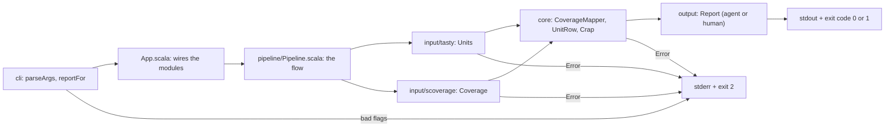

# crap4s

crap4s calculates the CRAP score (Change Risk Anti-Patterns, by Robert C. Martin) for Scala 3 code. It reads TASTy files and the coverage data from the Scala 3 compiler option `-coverage-out`.

## Install

Java 25 or later must be on the `PATH`.

```sh
mkdir -p ~/.local/bin && curl -fL -o ~/.local/bin/crap4s https://github.com/tomiwu/crap4s/releases/latest/download/crap4s && chmod +x ~/.local/bin/crap4s
```

## Example

```sh
crap4s --tasty target/scala-3.10.0/classes --coverage target/coverage \
  --classpath-file target/classpath.txt --threshold 6
```

Output in the `agent` format:

```text
src/Files.scala:12 Files.read cc=5 cov=0.20 crap=17.80
FAIL 1/100 max=17.80
```

## Flags

| Flag | Description | Default |
| --- | --- | --- |
| `--tasty <dir>` | Directory with TASTy files. Repeat for more directories. | required |
| `--coverage <dir>` | Directory with the `-coverage-out` data. Repeat for more directories. | required |
| `--classpath <entries>` | Dependency classpath. Separate entries with `:`. | none |
| `--classpath-file <file>` | File with the dependency classpath. | none |
| `--threshold <number>` | Fail units with a CRAP score above this number. | `6` |
| `--format agent\|human` | Output format. | `agent` |
| `--all` | List every unit, not only the units above the threshold. | off |
| `--help` | Print the help text. | |

| Exit code | Meaning |
| --- | --- |
| 0 | No unit is above the threshold. |
| 1 | A unit is above the threshold. |
| 2 | Bad input or error. The message goes to stderr. |

## Data flow



## More information

Refer to [docs/](docs/) for all other information. Start with [docs/usage.md](docs/usage.md).
